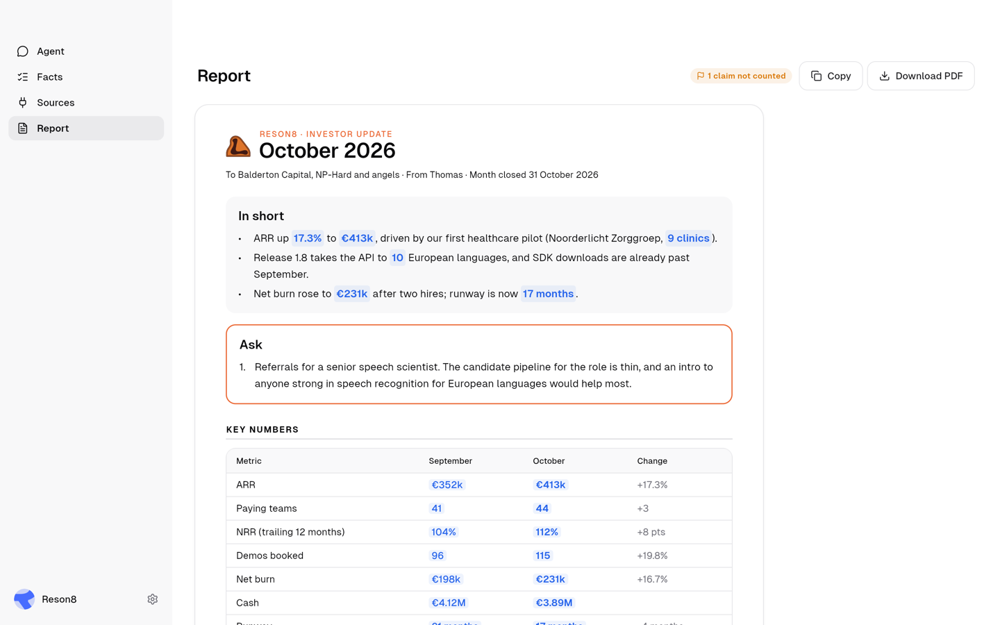
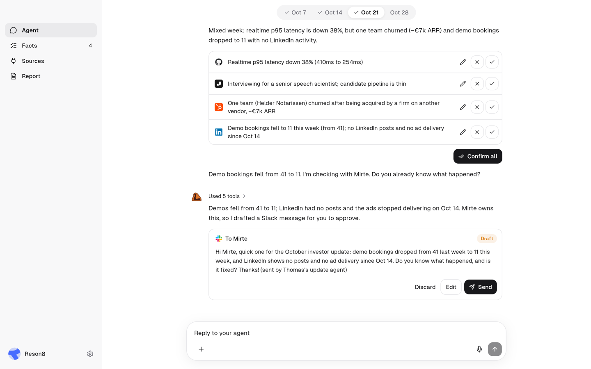
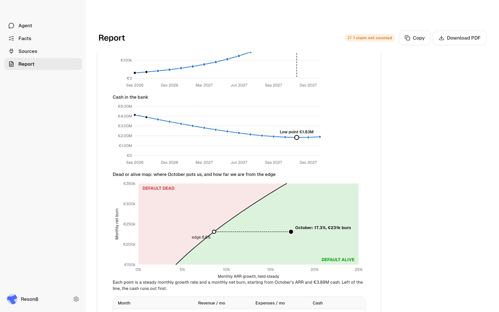
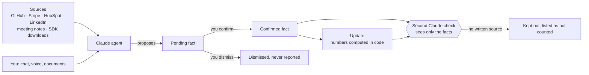
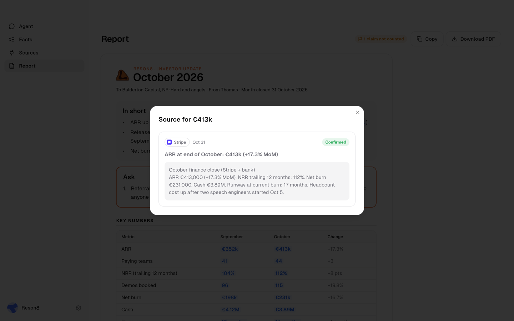
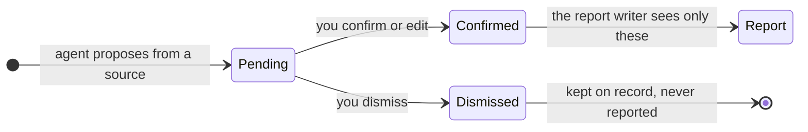

# Agentic Investor Updates: investor updates your investors can check

**Your monthly update, drafted from facts you confirmed, with a source behind every number.**

You owe your investors an update every month, and it usually gets written late on the 31st
from memory. Writing from memory, it's easy to recall the new customers and miss the one
that left. This app keeps track of the month for you. Each week an AI agent reads your company's tools, writes down what
changed and asks you to confirm it. When a number drops, it finds out who owns it and drafts
them a message. By the 31st the update is ready, and your investors can click any number in
it to see where it came from.

<p align="center"></p>
<p align="center"><em>The October update the agent drafted for the demo company. Every blue number opens its source.</em></p>

## What you get

- You confirm or fix facts as they come in each week, so the update is already drafted
  when the 31st arrives.
- Every figure in the update opens its source: the record, the date and the system it came
  from. Your investors can check any number themselves.
- A lost customer or a shorter runway goes in the same way a new customer does, once you've
  confirmed it.
- The update answers the question every investor has: at your current growth, do you reach
  profit before the cash runs out? That's Paul Graham's
  [default alive test](https://paulgraham.com/aord.html), worked out from your own numbers.
- Messages to teammates and the update itself wait for your approval.

## Try it in two minutes, no API keys needed

You need [Flutter](https://docs.flutter.dev/get-started/install) 3.35 or newer. The macOS
app also needs Xcode. The web build runs in Chrome without it.

```bash
git clone https://github.com/seanjanke/Agentic-Investor-Updates.git
cd Agentic-Investor-Updates
flutter pub get
flutter run -d chrome        # or: flutter run -d macos
```

Without keys the app runs in **scripted mode**: same tools, same screens, with the agent's
decisions replayed from the demo data. For live runs, copy `secrets.example.json` to
`secrets.json` and add `ANTHROPIC_API_KEY` (Claude) and `RESON8_API_KEY` (voice), then
start it with `--dart-define-from-file=secrets.json`. Settings > Agent switches scripted mode
on or off, and if a live call fails the step list shows an amber "Live run failed, finished
with the backup run" row.

**Click through October:**

1. Pick **Oct 7** in the week selector and click **Run the week 1 check-in**. Confirm the
   facts it found, and click **Add** when it suggests reporting NRR.
2. Do the same for **Oct 14**, **Oct 21** and **Oct 28**. In week 3, **Send** the message it
   drafted to Mirte, then click **Simulate reply from Mirte**.
3. Open **Facts** and click **Confirm** for anything still pending. A week can show more
   than one card to confirm, and an unconfirmed fact never reaches the update.
4. Click **Close October and draft the update**, then **Confirm & draft the update**, then
   open **Report**.

## The demo month

The app ships with one month of data for [Reson8](https://www.reson8.dev/), an Amsterdam
speech-to-text company. Reson8's funding, founders and product are public, and so are its
SDK download counts. The revenue, the customers and Mirte, the Head of Growth, are invented.

| Week | What the agent does |
| --- | --- |
| Oct 7 | Reads the sources and proposes facts to confirm. In a meeting note it spots the lead investor asking for net revenue retention (NRR, how much revenue existing customers keep and grow), and suggests reporting it. |
| Oct 14 | Logs a release and the first healthcare customer, a paid pilot across 9 clinics. Demo bookings hit a record 41. |
| Oct 21 | Logs a customer lost after an acquisition (−€7k a year). Sees demo bookings fall from 41 to 11, finds that Mirte owns LinkedIn and drafts her a Slack message. Her reply (the ad account was suspended over an expired card) becomes a fact. |
| Oct 28 | The healthcare customer says it wants all 14 clinics in Q1, but only says it in a meeting. |
| Close | October closes at €413k in annual recurring revenue (ARR), up 17.3% on September. The update is drafted, and the verifier keeps the "14 clinics" claim out because nothing in writing backs it. |

<p align="center"></p>
<p align="center"><em>Week 3: the agent spots the drop, works out that Mirte owns LinkedIn and drafts the question. It sends only when you click Send.</em></p>

The finished update has the sections investors expect: in short, the ask, key numbers
(September against October), default alive or dead with three charts, new and lost
customers with a chart of how ARR got from €352k to €413k, the pipeline that isn't counted yet, highlights, challenges, product, team, next
month and a list of every source it cites. **Download PDF** saves it as an A4 PDF, and
**Copy** puts a plain-text version on the clipboard.

<p align="center"></p>
<p align="center"><em>On the demo numbers: default alive, break-even in November 2027 with €1.83M left. Growth could fall to 8.6% a month before that flips.</em></p>

## Why it can't make up a number



- The agent can only propose facts. You confirm each one before the update can use it.
- Every number in the update, the charts and the default alive test is computed in code
  from confirmed facts. The model writes the sentences around them.
- A separate Claude call checks the draft. It sees each claim and the facts it cites, and
  nothing else, so it judges each claim only against the facts.

<p align="center"></p>
<p align="center"><em>Clicking €413k opens the Stripe record it came from.</em></p>

## How we know it works

- **`flutter test` passes.** `test/demo_flow_test.dart` runs the whole October month in
  scripted mode in about 30 seconds and checks:
  - the numbers: €413k ARR, 44 paying teams, 17 months of runway
  - default alive: break-even in month 13, €1.83M left, an 8.6% edge
  - that new and lost customers add up from €352k to €413k ARR
  - that exactly one claim, the 14 clinics, is kept out of the update
  - that the PDF is generated
  - that weeks can be run in any order

  A second test, `test/live_smoke_test.dart`, runs week 1 against the real Claude API when
  a key is set.
- **We clicked through it.** The web build was run in Chrome on 25 Oct 2026 with Flutter
  3.47.8, from the week 1 check-in to an approved update. The screenshots on this page come
  from that run.
- **One data source is real.** Download counts for Reson8's developer kits (its LiveKit
  plugins) were pulled from PyPI and npm on 24 Oct 2026: 30,735 downloads from 1 to 23 October, against
  21,568 in all of September.

## What is real and what is mocked

| Real | Mocked |
| --- | --- |
| The Claude agent and its 10 tools, the facts ledger, the report, the verifier, the approval step for messages, the whole interface, voice input through Reson8 | The five business sources read timestamped JSON in `assets/mock/` instead of live APIs |
| The SDK download counts | The week selector stands in for a weekly schedule |
| | Teammate replies come from a "Simulate reply" button instead of Slack |

Each source sits behind one interface, `SourceConnector.fetch(since, until)`, so a real
GitHub, Stripe, HubSpot or LinkedIn connector drops in without touching the agent.

## Built with

| | What it does here |
| --- | --- |
| **Claude** (`claude-sonnet-5-5`) | Runs the agent: the weekly check-in, chasing a dropped number, reading your chat and voice notes, and drafting the update. A second, separate call checks the draft. |
| **Reson8** | Turns the founder's voice into text, tuned to startup words like ARR, NRR, runway and customer names, so "NRR" doesn't come back as "an are are". |
| **Jamie** | Meeting notes as a source. Two of the month's most important facts, the investor asking for NRR and the 14 clinics, were only ever said out loud. |

Everything runs on your machine except the Claude and Reson8 calls.

<details>
<summary><strong>How it works in detail</strong>: the four agent runs, the tools and the repo layout</summary>

### Four agent runs, one set of tools

| Run | Starts when | Ends with |
| --- | --- | --- |
| A. Weekly check-in | You run a week's check-in | Facts to confirm and up to 3 questions |
| B. Anomaly | A number drops sharply (demos down 73%) | A message drafted to the owner, waiting for you |
| C. Inbound | You chat, speak or upload a document, or a teammate replies | New pending facts |
| D. Report | You close the month | The update, built from confirmed facts and checked by the verifier |

The 10 tools are `list_sources`, `fetch_source`, `ledger_search`, `ledger_propose`,
`suggest_kpi`, `team_directory`, `ask_founder`, `message_teammate` (needs your approval),
`submit_report` and `verify_claims`. They run locally and give the same answer every time.
The model decides which to call and writes the text.

### How a fact moves



### Repo layout

```
lib/
  agent/     Claude client, tools, prompts, the four runs, scripted fallback
  data/      source connectors and the team directory
  models/    facts, feed items, messages, report (with default alive)
  ui/        week selector, agent chat, facts, sources, report, charts, PDF, settings
  voice/     Reson8 client
assets/mock/ the October data, one JSON file per source
test/        demo_flow_test.dart (scripted month), live_smoke_test.dart (real Claude)
demo/        pitch deck, script, shot list, sample report, handoff, work log
```

The interface is Flutter with [shadcn_ui](https://pub.dev/packages/shadcn_ui). The app
window and logo still use the project's working name, "Ledger".

The pitch deck ([PDF](demo/deck.pdf)), narration script, backup-video shot list and a sample
investor report are in [`demo/`](demo/). Whoever runs the app on stage should read
[`demo/HANDOFF.md`](demo/HANDOFF.md) first.

</details>

## Next: your own month

Clone it and click through October today: it takes two minutes and no API keys. Then tell us
which source you'd connect first. The next connectors on the list are Granola, Salesforce,
Linear, Notion and Google Analytics, plus Claude Computer Use for dashboards that have no
API. [Open an issue](https://github.com/seanjanke/Agentic-Investor-Updates/issues) with
yours, and star the repo if you want to follow along.
