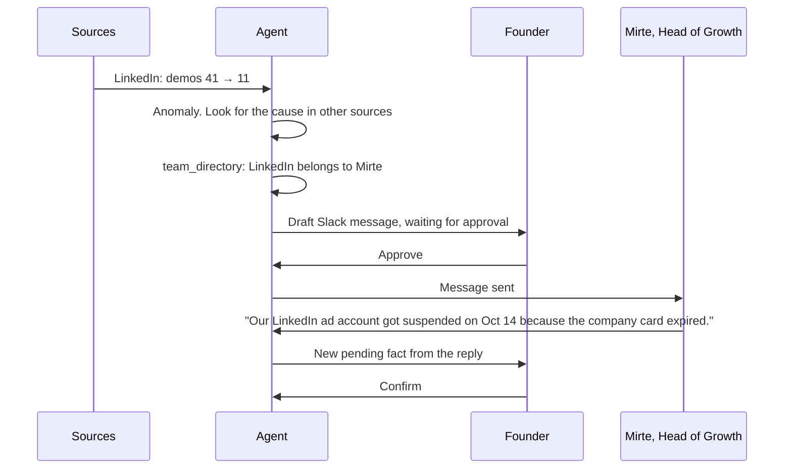
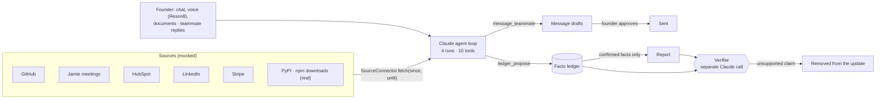
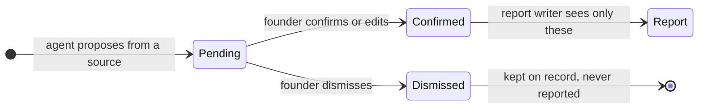

# Ledger

**Every number in your investor update, with its source.**

Founders owe their investors an update every month, and most write it late on the 31st
from memory, which keeps the wins and drops the churn. This agent collects the month while
it happens: each week it reads the company's tools, proposes facts for the founder to
confirm, and chases teammates when a number looks off. At month end the update is already
written from confirmed facts only, and every number in it opens its source.

<p align="center"></p>

<p align="center">
  <a href="#run-it">Run it</a> ·
  <a href="#the-demo">The demo</a> ·
  <a href="#how-it-works">How it works</a> ·
  <a href="demo/">Demo kit and slides</a>
</p>

Demo video: _link coming_

## Run it

```bash
cp secrets.example.json secrets.json   # add ANTHROPIC_API_KEY and RESON8_API_KEY
flutter pub get
flutter run -d macos --dart-define-from-file=secrets.json
```

You don't need any keys to try it. Without an `ANTHROPIC_API_KEY` the app runs in
**scripted mode**, with the same tools and UI, and with decisions taken from the mock data
instead of the model. If a live run fails, the app falls back to the scripted run
automatically, and the agent's step list shows an amber "Live run failed, finished with
the backup run" row. Scripted mode can also be switched on under Settings > Agent.

`SLACK_WEBHOOK_URL` is optional. If it is set, approved Slack messages are also posted
there.

## The demo

The app follows **Reson8**, an Amsterdam speech-recognition company (a domain-adaptable ASR
API for 10 European languages, €5M pre-seed led by Balderton), through October 2026. The
financials, customers and Mirte are invented for the demo; the founders, funding and product
facts are public. Pick a week in the week selector at the top, then start its check-in from
the card in the chat. After week 4, the card closes the month.

| Week | What happens |
| --- | --- |
| 1 | Check-in: 2 new paying teams, barge-in tuning for the Turns API, 29 demos. The agent sees in a Jamie meeting note that Balderton asked for NRR, and suggests adding it to the KPIs. Thomas adds by voice that two engineers started. |
| 2 | Release 1.8 (10 GA languages), Noorderlicht Zorggroep pilot (9 clinics, +€41k ARR), a record 41 demos. |
| 3 | Demos drop to 11. The agent investigates, finds that Mirte owns LinkedIn, and drafts a Slack message. Thomas approves it, and Mirte's reply becomes a fact. |
| 4 | Release 1.9. Noorderlicht says it wants all 14 clinics in Q1, but only in a meeting. |
| Close | October numbers come in (€413k ARR, +17.3%). The agent drafts the update, and a separate verifier removes the "14 clinics" claim, which was only said in a meeting. |

Under the KPI table, the update answers Paul Graham's
[default alive or default dead](https://paulgraham.com/aord.html) question. It is computed
in code from confirmed ARR, net burn and cash, assuming flat costs; the model never writes
it. On the demo data: default alive, break-even in 13 months with €1.83M left, and default
dead below about 8.6% monthly growth.

The week 3 chase, step by step:



## How it works



It is one Flutter macOS app with a [shadcn_ui](https://pub.dev/packages/shadcn_ui)
interface. Everything runs locally except the Claude and Reson8 API calls.

### Four agent runs, one tool set

| Run | Trigger | Ends with |
| --- | --- | --- |
| A. Weekly check-in | Founder-set cadence (week selector + check-in card) | Check-in card: facts to confirm, 1 to 3 questions |
| B. Anomaly investigation | A metric drops sharply (demos −73%) | A message draft to the owner, waiting for approval |
| C. Inbound processing | Founder chat, voice, document, or a teammate's reply | Proposed facts in the ledger |
| D. Period report | End of the month | An update built from confirmed facts, checked by a separate verifier call |

Tools: `list_sources`, `fetch_source`, `ledger_search`, `ledger_propose`, `suggest_kpi`,
`team_directory`, `ask_founder`, `message_teammate` (needs approval), `submit_report`,
`verify_claims`. The tools run locally and deterministically. The model chooses which to
call and writes the text. The KPI table is computed from the ledger in code, and the model
never writes it.

### How a fact gets into the update



The verifier gets each claim in the draft together with the ledger facts it cites, and
nothing else. It never sees the reasoning that produced the report, so it can't be talked
into agreeing with it.

## What is mocked, and how real connectors plug in

- **Sources** are timestamped JSON in `assets/mock/`. Each connector only returns data up
  to the simulated date. A real connector implements the same
  `SourceConnector.fetch(since, until)`: OAuth for GitHub, HubSpot, Stripe and LinkedIn,
  the Jamie API for meetings, and Computer Use for dashboards without an API.
- **SDK downloads (PyPI · npm)** are the one real data source: download counts for Reson8's
  LiveKit plugins, pulled from pypistats.org and api.npmjs.org on 24 Oct 2026. They include
  CI installs, so they track developer adoption, not users.
- **Scheduling.** The week selector and check-in card stand in for a cron job per founder. Anomaly
  checks would run from webhooks.
- **Teammate messages.** Drafts are approved in the app and shown as sent. Replies come
  from the "Simulate reply" button. Slack, WhatsApp and email are all channels of the same
  `message_teammate` tool.

## Partner tech

| | Role |
| --- | --- |
| **Claude** (`claude-sonnet-5-5`) | The agent loop for all four runs, plus the separate verifier. |
| **Reson8** | Voice input through the prerecorded speech-to-text API, biased with a custom model of startup vocabulary (ARR, NRR, churn, runway, company and people names). |
| **Jamie** | Meeting notes as a source (mocked). Two of the month's most important facts were only ever said out loud. |

## Repo layout

```
lib/
  agent/     Claude client (manual tool-use loop), tools, prompts, the four runs, scripted fallback
  data/      source connectors and the team directory
  models/    facts, feed items, outbound messages, report (incl. default alive), agent runs
  ui/        shell and week selector, agent chat, facts, sources, report, settings, widgets
  voice/     Reson8 client
assets/mock/ the October dataset, one JSON file per source
test/        demo_flow_test.dart runs the whole October scenario in scripted mode
demo/        pitch deck, script, shot list, Reson8 dataset, investor report, handoff notes, work log
```

## Tests

```bash
flutter test
```

`test/demo_flow_test.dart` runs the whole October scenario in scripted mode and checks the
final report against the Reson8 numbers (€413k ARR, 44 paying teams, 17 months runway,
default alive). It also checks that weeks can be run in any order, that flagged claims stay
out of the exported update, and that the update contains no em or en dashes.

`test/live_smoke_test.dart` runs the week 1 check-in against the real Claude API. It costs a
few cents and is skipped without a key:

```bash
flutter test test/live_smoke_test.dart --dart-define-from-file=secrets.json
```

## Presenting it

Everything for the pitch is in [`demo/`](demo/):

- **Deck:** HTML that runs offline in Chrome.
- **Script:** narration in 3, 5½ and 8 minute cuts.
- **Shot list:** for the backup recording.
- **Pitch review:** independent judges scored the pitch against Ogilvy's 15 principles, 84.5/100 after three rounds of edits.
- **Investor report:** a sample October investor update (PDF), with a default alive map,
  new customers and challenges.

Start with [`demo/README.md`](demo/README.md). [`demo/HANDOFF.md`](demo/HANDOFF.md) says
what whoever drives the app needs to do, and [`demo/WORKLOG.md`](demo/WORKLOG.md) records every
change to the kit, PR by PR.

<p align="center"></p>

<p align="center"></p>
