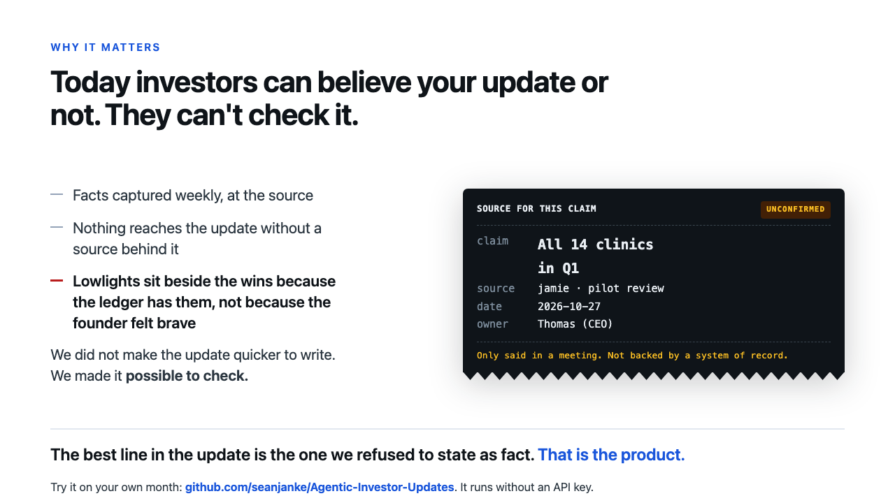
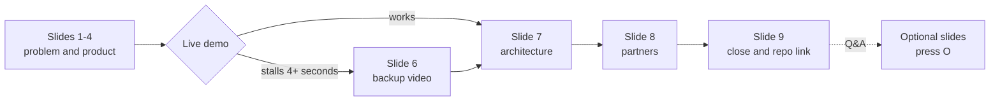
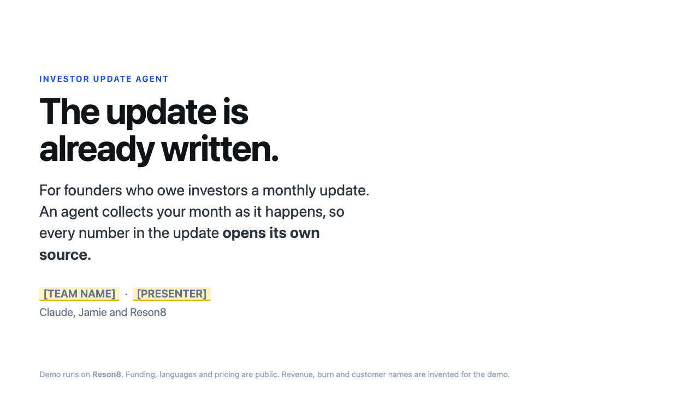
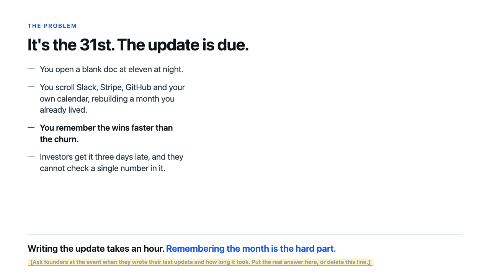
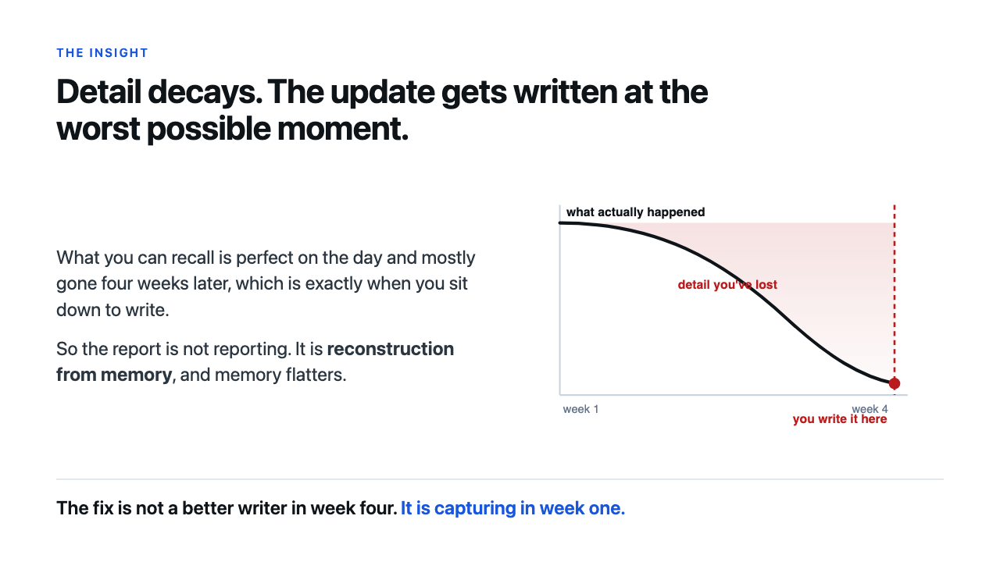
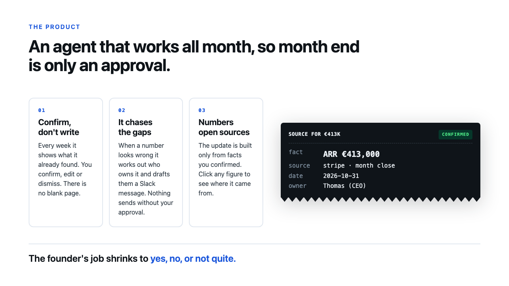
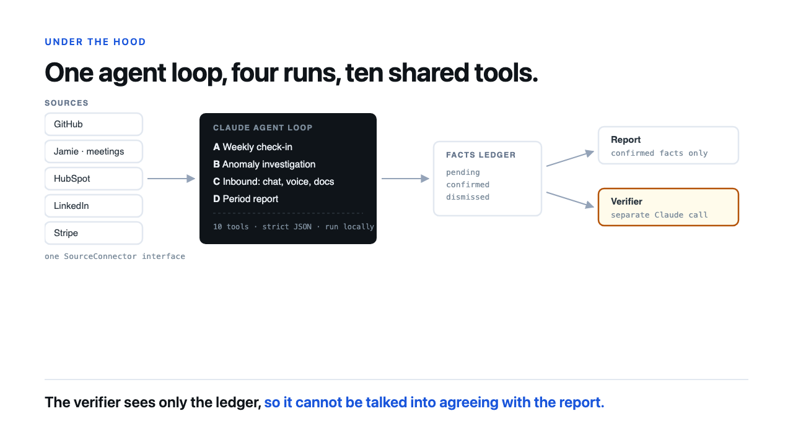
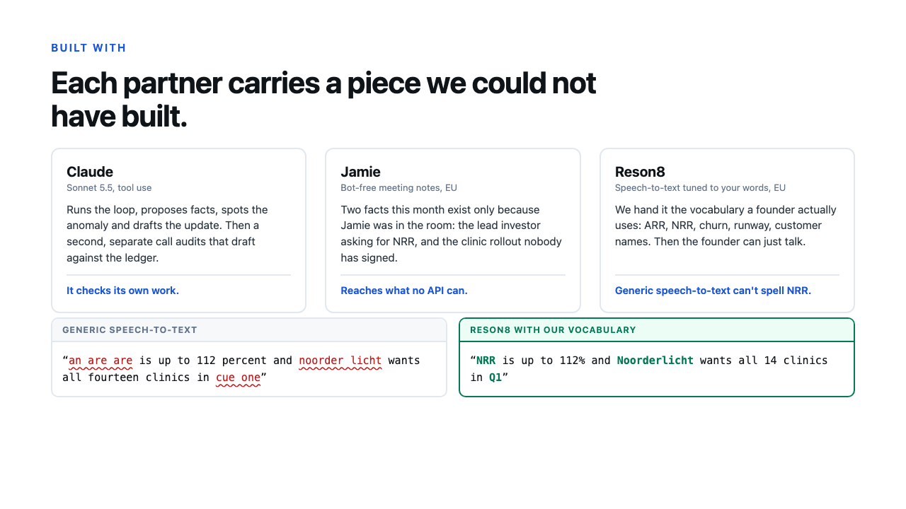
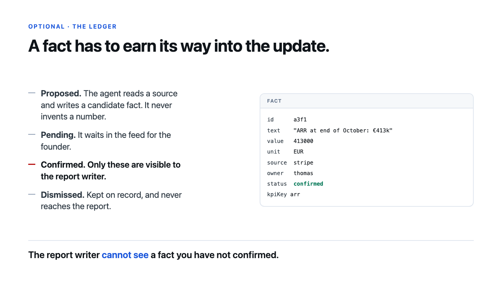
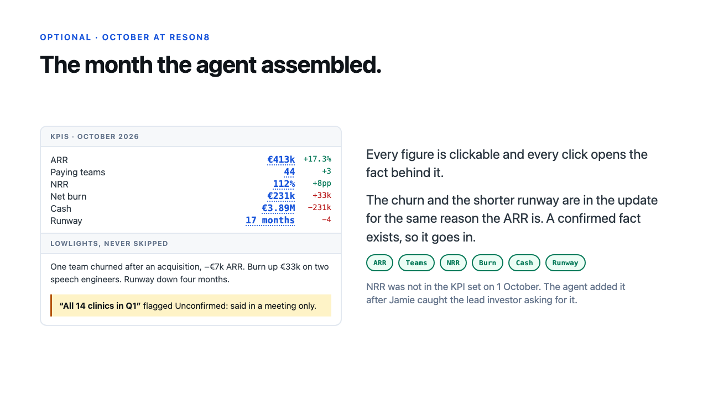

# Demo kit

Everything needed to present Investor Update Agent: the deck, what to say, how to record
the backup video, and the Reson8 dataset the demo runs on.

<p align="center"></p>

## What's in here

| File | Use it for |
| --- | --- |
| [`deck.html`](deck.html) | The slides. Open in Chrome, press `F` for fullscreen. Self-contained, so it needs no network, fonts or build step. |
| [`script.md`](script.md) | Word-for-word narration in three cuts (3, 5½ and 8 minutes), the demo click-path, what to say if the demo stalls, Q&A answers, rehearsal checks. |
| [`shotlist.md`](shotlist.md) | Shot-by-shot plan for the backup recording, done as one continuous take. |
| [`HANDOFF.md`](HANDOFF.md) | Every code change needed to run the app on the Reson8 data. For whoever drives the app. |
| [`reson8-mock/`](reson8-mock/) | Drop-in replacement for `assets/mock/`, telling the October story for Reson8. |
| [`pitch-review.md`](pitch-review.md) | The deck scored against 15 Ogilvy principles, before and after, plus a written version of the pitch for submission forms. |
| [`img/`](img/) | Slide renders used in the READMEs. |

## Deck keys

| Key | Does |
| --- | --- |
| `→` `←` or click | Next and previous slide |
| `F` | Fullscreen |
| `S` | Speaker notes, with the target time for each slide |
| `O` | Show or hide the four optional slides (ledger, October report, what is real, the business) |
| `#5` in the URL | Jump straight to slide 5, handy in Q&A |

The deck opens with the optional slides hidden.

## Before you present

Do these in order. The first four take five minutes. The rest depend on the app.

- [ ] Find out the slot length and pick a cut in `script.md`.
- [ ] Replace `[TEAM NAME]` and `[PRESENTER]` on slide 1.
- [ ] Ask a few founders at the event when they last wrote an investor update and how long
      it took. Put the best answer in the yellow line on slide 2, or delete the line.
- [ ] Run the rehearsal checks at the end of `script.md` on someone who hasn't seen it.
- [ ] Apply `HANDOFF.md` so the app runs on Reson8, and tick its checklist.
- [ ] Do a live run and confirm the model row reads `claude-sonnet-5-5`, not `scripted` or
      `fallback`.
- [ ] Record `demo-backup.mp4` following `shotlist.md` and save it next to `deck.html`.
      Slide 6 plays it.
- [ ] Turn on Do Not Disturb on the presenting laptop.

## Run order on the day



If the demo stalls, say "I'll show you the recording, it's the same run", press `→`, and
keep narrating the same beats over the video. Don't debug on stage.

## The demo company

The app ships with Shelfwise, a fictional grocery SaaS. For the pitch we run the same
October story on [Reson8](https://www.reson8.dev/), the speech-to-text partner, because
their own numbers make a better demo than an invented company.

```bash
cp demo/reson8-mock/*.json assets/mock/   # from the repo root, then apply HANDOFF.md
```

Reson8's funding, founders, languages, API surface, certifications and pricing are public.
Every revenue, burn, cash, runway and customer figure is invented for the demo, along with
all customer names and the Head of Growth, Mirte. The title slide says so.

| | September | October |
| --- | --- | --- |
| ARR | €352k | €413k (+17.3%) |
| Paying teams | 41 | 44 |
| NRR | 104% | 112% |
| Net burn | €198k | €231k |
| Runway | 21 months | 17 months |

Weekly demo bookings run 29, 41, 11, 34. The week 3 drop is 73%, the same as the Shelfwise
data, so the anomaly detector fires without retuning.

## Slides

| | |
| --- | --- |
|  |  |
|  |  |
|  |  |
|  |  |
