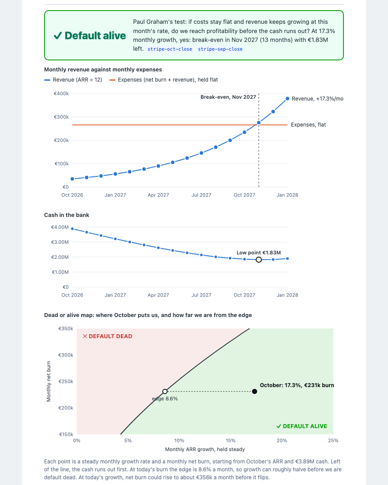

# Investor report

A full monthly investor update for Reson8's October 2026, built from the same data the app
uses. Send it to investors as a PDF, or open it in a browser to show what the agent produces.

<p align="center"></p>

**This is demo data.** Revenue, burn, cash, customers, deals and meeting notes are invented.
The SDK download counts are real. The report says so in a banner at the top. Don't send it to
anyone who might read it as Reson8's real numbers.

## Files

| File | What it is |
| --- | --- |
| [`october-2026.pdf`](october-2026.pdf) | The report, ready to attach to an email. |
| [`october-2026.html`](october-2026.html) | The same report. Opens in any browser, and the source tags link to the source list. |
| [`build.py`](build.py) | Generates the HTML from `../reson8-mock/`. No dependencies beyond Python 3. |

## What's in it

The sections follow the usual structure of a monthly update (TL;DR, asks, metrics,
highlights, lowlights, next steps), with a default alive section and a challenges section added:

- **In short.** Three lines: the headline numbers, default alive or dead, and the lowlights.
- **Ask.** One specific request: referrals for the senior speech scientist role.
- **Key numbers.** September against October for ARR, paying teams, NRR, demos, burn, cash and
  runway. Each row is tagged with its source record.
- **Default alive or default dead.** The verdict, a revenue against expenses chart with the
  break-even month, the cash curve, and a **dead or alive map**. The map plots monthly growth
  against monthly burn, and shows where October sits and how far it is from the edge.
- **Customers.** New customers, the one loss, and a bridge showing how ARR got from €352k to €413k.
- **Pipeline we are not counting yet.** Noorderlicht's 14-clinic rollout, which was only said in
  a meeting and isn't in any number.
- **Challenges.** Each one with its cause, and the fix where there is one: higher burn and
  shorter runway, the week 42 demo drop, the churned customer, the hiring pipeline.
- **Product, Growth, Team, Next month.**
- **Sources.** Every record the report cites, with its date.

## How the numbers are made

`build.py` reads the mock JSON and computes everything: the deltas, the ARR bridge (it stops
with an error if the bridge doesn't add up), and the default alive test.

Default alive uses the same model as `AppState.buildDefaultAlive` in the app: expenses stay
flat at October's level, revenue keeps growing at October's rate (17.3% a month), and the gap
comes out of cash. That gives break-even in November 2027 with €1.83M left, and an edge of
8.6% monthly growth. The map runs that same test for every pair of growth rate and burn.

## Rebuild it

```sh
python3 demo/investor-report/build.py
"/Applications/Google Chrome.app/Contents/MacOS/Google Chrome" --headless=new \
  --no-pdf-header-footer --print-to-pdf=demo/investor-report/october-2026.pdf \
  "file://$PWD/demo/investor-report/october-2026.html"
```

Or open the HTML in Chrome and use Print, then Save as PDF.
